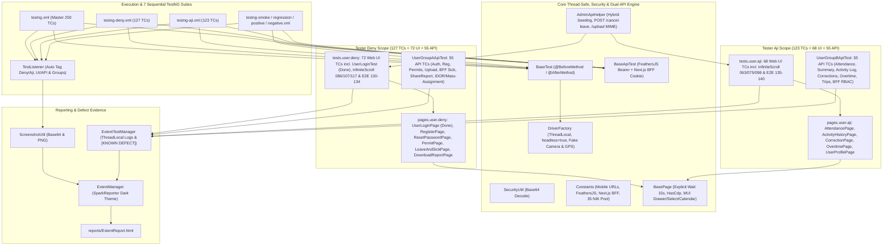

# 📋 Implementation Plan: Enterprise Karyawan Automation Framework (`magang.dikahadir.com`) — SIT v4

## Goal Description
Membangun **Enterprise Web UI & API Test Automation Framework** khusus untuk **portal Karyawan / User Magang (Mobile Mirroring)** pada platform **[HADIR Mobile Mirroring](https://magang.dikahadir.com/absen/login)** yang **100% selaras** secara arsitektur, versi dependensi, standar keamanan kredensial, pola eksekusi sekuensial, konvensi *Strict QA Known Defect*, dan pembagian kerja tim dengan repositori **Web Admin (`final-project-admin`)** serta acuan standar pada [reference.md](file:///c:/Users/Asus/Documents/JuaraCoding/Final/final-project-karyawan/reference.md).

Kerangka kerja ini menggunakan **Java 21 LTS**, **Apache Maven**, **Selenium WebDriver `4.52.0`** (default `headless = true`), **REST Assured `6.3.0`**, **TestNG `7.12.0`**, **ExtentReports `5.1.2`** (Dark Theme + Base64 failure screenshot), **Apache POI `5.2.5`**, dan **Jackson Databind `2.17.2`**, mencakup **250 Test Cases User (SIT v4)** (**140 Web UI** + **110 REST Assured API**) dengan *Single Source of Truth* pada [docs/SIT_Scenario_Magang_Hadir.xlsx](file:///c:/Users/Asus/Documents/JuaraCoding/Final/final-project-karyawan/docs/SIT_Scenario_Magang_Hadir.xlsx) dan [WebKaryawanPrompt.md](file:///c:/Users/Asus/Documents/JuaraCoding/Final/final-project-karyawan/WebKaryawanPrompt.md).

---

## Ringkasan Keputusan Teknis & Standar SIT v4

> [!IMPORTANT]
> **1. Tech Stack, Default Headless & Eksekusi Sekuensial**
> - **Runtime & Build**: Java 21 LTS, Apache Maven `3.9+`, `maven-compiler-plugin` `3.13.0`, `maven-surefire-plugin` `3.5.0`.
> - **Libraries**: Selenium WebDriver `4.52.0`, REST Assured `6.3.0` (`rest-assured`, `json-path`, `json-schema-validator`), TestNG `7.12.0`, ExtentReports `5.1.2`, Apache POI `5.2.5` (`poi`, `poi-ooxml`), Jackson Databind `2.17.2`, Commons IO `2.16.1`, SLF4J `2.0.16`.
> - **Default Headless**: Chrome **WAJIB** default `headless = true` di `DriverFactory.java`, `BaseTest.java`, `pom.xml`, dan ketujuh file `testng*.xml`, namun dapat dioverride kapan saja melalui `-Dheadless=false`.
> - **Sequential Execution**: Seluruh 7 suite TestNG dijalankan **sekuensial** (tanpa `parallel="classes"`) untuk mencegah tabrakan sesi pada akun bersama `hadirsqa1@gmail.com` serta menghindari rate-limit/timeout firewall pada staging `api-dev.dikahadir.com`.
> - **Simulasi Kamera & GPS (Mobile Mirroring)**: `DriverFactory.java` mengaktifkan `--use-fake-ui-for-media-stream`, `--use-fake-device-for-media-stream`, serta Chrome `prefs` untuk `geolocation = 1` dan `media_stream_camera = 1`. Skenario negatif GPS luar radius / permission diblokir (`SIT_USR_UI_043`, `044`, `045`) serta E2E geofence (`SIT_USR_UI_135`) menggunakan **CDP** via `HasCdp#executeCdpCommand`.

### 2. Keamanan Kredensial Base64 (`SecurityUtil.java`)
- **Zero Plaintext Policy**: Dilarang keras menuliskan password plaintext di file `.java`, komentar kode, `pom.xml`, maupun `testng*.xml`.
- `SecurityUtil.java` memanfaatkan `java.util.Base64` untuk melakukan `decode(...)` di memori saat runtime.
- Konstanta di `Constants.java`:
  - `USER_EMAIL = "hadirsqa1@gmail.com"` (NIK: `D6201031`, Nama: `Hadir SQA Testing 1`)
  - `USER_PASSWORD_ENCODED = "U1FBQEhhZGlyMTIzNDU="`
  - `HYBRID_ADMIN_EMAIL = "admin@hadir.com"`
  - `HYBRID_ADMIN_PASSWORD_ENCODED = "TWFnYW5nU1FBX0pDQDEyMw=="`
  - `VALID_NIK_POOL`: 35 NIK master DIKA terverifikasi (`D7231978` s/d `D7240029`, selaras dengan `EmployeeApiHelper` di proyek Admin).

### 3. Dual-Layer Backend Architecture: FeathersJS vs Next.js BFF (SIT v4)
- **FeathersJS Backend (`API_BASE_URI = "https://api-dev.dikahadir.com/hadir-api-magang"`)**:
  - Menggunakan `RestAssured.useRelaxedHTTPSValidation()` dan autentikasi Bearer JWT dari `POST /authentication`.
  - Endpoint terverifikasi: `/authentication`, `/auth-management`, `/users`, `/user-summary` *(bukan `/users/summary`)*, `/activity`, `/activity/request-activity`, `/activity-correction`, `/overtime`, `/off-permit`, `/late-permit`, `/early-leave`, `/business-trips`, `/project-leave` *(termasuk `GET /project-leave/{userId}`)*, `/cancel-leave` *(pembatalan cuti oleh Admin menggunakan `POST /cancel-leave` dengan `leave_trans_id` & `lv_approve_notes`)*, `/sick`, `/share-report`, `/upload` *(multipart field `uri` dengan MIME eksplisit `image/jpeg` atau `image/png`)*, dan `/location-point`.
  - **Aturan Filter Tanggal `GET /activity`**: Gunakan operator FeathersJS `created_at[$gte]` dan `created_at[$lte]` — **jangan** menggunakan `startDate`/`start_date` yang memicu SQL 500 `Unknown column`.
- **Static Uploads Host (`API_STATIC_UPLOADS_BASE_URI = "https://api-dev.dikahadir.com/uploads"`)**: Verifikasi aksesibilitas file gambar hasil upload.
- **Next.js BFF Routes (`BASE_URL = "https://magang.dikahadir.com"`)**:
  - Menggunakan cookie sesi `hadir_app_magang` hasil `POST /api/login`:
    - `/api/sick` & `/api/activity/sick` (`SIT_USR_API_068–071`)
    - `/api/leave/project-leave/{other_id}` (`SIT_USR_API_077`)
    - `/api/client/generate-report`, `/api/client/leave-report`, `/api/client/overtime-report` (`SIT_USR_API_097–099` — RBAC non-client isolation).

---

## Arsitektur Sistem (SIT v4 — 250 User TCs)



---

## Pembagian Tugas Adil 2 Tester (SIT v4 — Total 250 TCs)

Mengacu langsung pada [docs/SIT_Scenario_Magang_Hadir.xlsx](file:///c:/Users/Asus/Documents/JuaraCoding/Final/final-project-karyawan/docs/SIT_Scenario_Magang_Hadir.xlsx) v4:

| Tester | Cakupan Web UI (`140 TCs`) | Cakupan REST Assured API (`110 TCs`) | Total & Bobot |
| :--- | :--- | :--- | :---: |
| **👤 Tester Deny** | **72 Web UI TCs** (`pages.user.deny` & `tests.user.deny`):<br>1. `UserLoginTest` — `Autentikasi-Login` (`SIT_USR_UI_001–012`: 12 TCs — **✅ Selesai & Terintegrasi di `main`**)<br>2. `RegisterTest` — `Autentikasi-Register` (`SIT_USR_UI_013–025`: 13 TCs)<br>3. `ResetPasswordTest` — `Autentikasi-Reset Password` (`SIT_USR_UI_026–033`: 8 TCs, termasuk OTP)<br>4. `PermitTest` — `Pengajuan-Izin` (`SIT_USR_UI_076–086`: 11 TCs — *Hybrid* + *InfiniteScroll* `086`)<br>5. `LeaveAndSickTest` — `Pengajuan-Cuti & Sakit` (`SIT_USR_UI_099–117`: Cuti `099–107` [9] + Sakit `108–117` [10] = 19 TCs + *InfiniteScroll* `107`, `117`)<br>6. `DownloadReportTest` — `Profil-Download Report` (`SIT_USR_UI_126–129`: 4 TCs `/apps/absent/reports/share_report`)<br>7. `UserCrossModuleDenyE2ETest` — `Integrasi Lintas Modul (Hybrid API+UI)` (`SIT_USR_UI_130–134`: 5 TCs) | **55 API TCs** (`UserGroupAApiTest`):<br>1. User Auth & `/auth-management` Reset Password (`SIT_USR_API_001–010`: 10 TCs)<br>2. Registration & NIK Check (`SIT_USR_API_011–018`: 8 TCs)<br>3. Leaves/Izin/Sakit + Late/Early Permits (`SIT_USR_API_044–049, 056–063`: 14 TCs)<br>4. Multipart Upload Security & Next.js BFF Sick Docs (`SIT_USR_API_064–071`: 8 TCs)<br>5. Share Report Export & IDOR (`SIT_USR_API_072–075`: 4 TCs)<br>6. Project-Leave, Profile, Critical IDOR & Mass-Assignment Security (`SIT_USR_API_053–055, 076–083`: 11 TCs) | **127 TCs** (50.8%) |
| **👤 Tester Aji** | **68 Web UI TCs** (`pages.user.aji` & `tests.user.aji`):<br>1. `AttendanceTest` — `Presensi-Beranda` (`SIT_USR_UI_034–053`: 20 TCs — *Fake Camera/GPS & CDP*)<br>2. `ActivityHistoryTest` — `Presensi-Log Absen` (`SIT_USR_UI_054–064`: 11 TCs + *InfiniteScroll* `063`)<br>3. `CorrectionTest` — `Pengajuan-Koreksi Absen` (`SIT_USR_UI_065–075`: 11 TCs — *Hybrid* + *InfiniteScroll* `075`)<br>4. `OvertimeTest` — `Pengajuan-Lembur` (`SIT_USR_UI_087–098`: 12 TCs `/apps/absent/overtime-client` — *Hybrid* + *InfiniteScroll* `098`)<br>5. `UserProfileTest` — `Profil-Menu Utama & Ubah Password` (`SIT_USR_UI_118–125`: 8 TCs — tanpa Password Lama)<br>6. `UserCrossModuleAjiE2ETest` — `Integrasi Lintas Modul (Hybrid API+UI)` (`SIT_USR_UI_135–140`: 6 TCs, termasuk E2E Kuota Cuti `140`) | **55 API TCs** (`UserGroupBApiTest`):<br>1. Attendance Clock-In/Out, `/activity/request-activity` & `/user-summary` (`SIT_USR_API_019–030, 090–096`: 19 TCs)<br>2. Activity Log (`created_at[$gte]`/`[$lte]`) & IDOR Security (`SIT_USR_API_031–038`: 8 TCs)<br>3. Corrections (`SIT_USR_API_039–043`: 5 TCs)<br>4. Overtimes & Business Trips (`SIT_USR_API_050–052, 084–089`: 9 TCs)<br>5. Leader/Client BFF Isolation (`/api/client/*`), Query Hardening (`$limit`, `$skip`, operator injection) & Self-Approval RBAC (`SIT_USR_API_097–110`: 14 TCs) | **123 TCs** (49.2%) |
| **TOTAL** | **140 Web UI TCs** | **110 API TCs** | **250 TCs** |

---

## Konvensi Penulisan Test: Strict QA Known Defect, Next.js/MUI & Git Opsi B

1. **Pola Strict QA untuk `Ready (Known Defect)`**:
   - Kolom `Expected Result` selalu berisi perilaku standar aplikasi yang seharusnya, sedangkan bug live dicatat pada kolom `Actual Result / Defect Notes`.
   - Untuk 10 skenario Known Defect Karyawan (`SIT_USR_UI_024`, `042`, `049`, `056`, `093`, `104`, `110`, `111`, `140`, serta `SIT_USR_API_047`), test **wajib tetap melakukan assertion terhadap Expected Result standar** dengan pesan assertion diawali prefix **`"[KNOWN DEFECT] ..."`** serta log `ExtentTestManager.logInfo(...)` yang mencantumkan `Severity` & `Priority` agar temuan bug terekam transparan di `reports/ExtentReport.html`.
2. **Standar Grup TestNG (`@Test(groups = ...)` untuk 4 Suite Kategori)**:
   - Setiap `@Test` wajib mencantumkan `"regression"` ditambah `"positive"` atau `"negative"`, serta `"smoke"` khusus jalur kritis (*critical path*) sesuai kolom `Test Suite` di Excel SIT v4.
3. **Teknik Interaksi Komponen Next.js/MUI & Pergantian Sesi**:
   - Gunakan `openSwipeableDrawerWithRetry(By)` pada `BasePage` untuk membuka `SwipeableDrawer` (menghindari intersepsi overlay bawah MUI).
   - Gunakan `openMuiSelectWithMouseDown(WebElement)` untuk membuka listbox MUI `Select` di dalam Drawer dan `dispatchCalendarDayMouseEvents(WebElement)` untuk memilih tanggal pada `react-date-range`.
   - Gunakan `scrollToBottomForInfiniteScroll()` untuk 6 daftar riwayat Mobile (`Log Absen` `063`, `Koreksi` `075`, `Izin` `086`, `Lembur` `098`, `Cuti` `107`, `Sakit` `117`).
   - Pada skenario E2E yang berpindah akun di tengah satu `@Test`, panggil `DriverFactory.quitDriver()` + `DriverFactory.initDriver(browser, headless)` (`resetBrowserSession()`) agar cookie HTTP-only Next.js benar-benar bersih.
4. **Git Workflow (Opsi B — Zero Merge Conflict)**:
   - Setiap fitur baru dikerjakan di branch terisolasi dari `main`:
     - **Tester Deny**: `feature/deny-user-login` *(✅ terintegrasi ke `main`)*, `feature/deny-user-register`, `feature/deny-user-reset-password`, `feature/deny-user-permit`, `feature/deny-user-leave-sick`, `feature/deny-user-download-report`, `feature/deny-user-e2e`, `feature/deny-user-api-a`
     - **Tester Aji**: `feature/aji-user-attendance`, `feature/aji-user-activity`, `feature/aji-user-correction`, `feature/aji-user-overtime`, `feature/aji-user-profile`, `feature/aji-user-e2e`, `feature/aji-user-api-b`

---

## Struktur Direktori Target (`final-project-karyawan/`)

```text
final-project-karyawan/
├── pom.xml                                  # Java 21, Selenium 4.52.0, REST Assured 6.3.0, TestNG 7.12.0, ExtentReports 5.1.2
├── .gitignore
├── .gitattributes
├── .editorconfig
├── reference.md
├── plan.md
├── tasklist.md
├── WebKaryawanPrompt.md
├── docs/
│   └── SIT_Scenario_Magang_Hadir.xlsx       # Single Source of Truth Matriks SIT v4 (250 User TCs: 140 UI + 110 API)
├── reports/
│   ├── ExtentReport.html                    # Dark Theme HTML + Base64 screenshots
│   └── screenshots/
└── src/
    ├── main/java/com/juaracoding/magang/
    │   ├── drivers/
    │   │   └── DriverFactory.java           # ThreadLocal WebDriver, headless=true default, fake camera & GPS prefs
    │   ├── pages/
    │   │   ├── BasePage.java                # Explicit wait 15s, MUI Drawer/Select/Calendar, InfiniteScroll, HasCdp, isImageBroken
    │   │   └── user/
    │   │       ├── deny/                    # UserLoginPage (Done), RegisterPage, ResetPasswordPage, PermitPage, LeaveAndSickPage, DownloadReportPage
    │   │       └── aji/                     # AttendancePage, ActivityHistoryPage, CorrectionPage, OvertimePage, UserProfilePage
    │   ├── reports/
    │   │   ├── ExtentManager.java           # Singleton ExtentSparkReporter (Dark Theme, 250 TCs metadata)
    │   │   └── ExtentTestManager.java       # ThreadLocal logging + logInfo/logPass/logFail
    │   └── utils/
    │       ├── Constants.java               # Base64 credentials, Mobile URLs, FeathersJS + Next.js BFF routes, 35 VALID_NIK_POOL
    │       ├── SecurityUtil.java            # Base64 decoder/encoder
    │       └── ScreenshotUtil.java          # Base64 & PNG screenshot capture
    └── test/
        ├── java/com/juaracoding/magang/
        │   ├── BaseTest.java                # @BeforeMethod / @AfterMethod WebDriver lifecycle (default headless=true)
        │   ├── listeners/
        │   │   └── TestListener.java        # Auto-tag Deny/Aji, UI/API, groups, Base64 screenshot on failure
        │   ├── api/
        │   │   ├── BaseApiTest.java         # FeathersJS Bearer spec + Next.js BFF Cookie spec + /authentication & /api/login
        │   │   ├── helper/
        │   │   │   └── AdminApiHelper.java  # Hybrid seeding, POST /cancel-leave, /project-leave/{id}, /upload MIME, E2E helpers
        │   │   └── user/
        │   │       ├── UserGroupAApiTest.java # Tester Deny (55 API TCs)
        │   │       └── UserGroupBApiTest.java # Tester Aji (55 API TCs)
        │   └── tests/user/
        │       ├── deny/                    # UserLoginTest (Done), RegisterTest, ResetPasswordTest, PermitTest, LeaveAndSickTest, DownloadReportTest, UserCrossModuleDenyE2ETest
        │       └── aji/                     # AttendanceTest, ActivityHistoryTest, CorrectionTest, OvertimeTest, UserProfileTest, UserCrossModuleAjiE2ETest
        └── resources/
            ├── testng.xml                   # Master Sequential Suite Karyawan (250 TCs, headless=true)
            ├── testng-deny.xml              # Sequential Suite Tester Deny (127 TCs, headless=true)
            ├── testng-aji.xml               # Sequential Suite Tester Aji (123 TCs, headless=true)
            ├── testng-smoke.xml             # Category Suite: smoke
            ├── testng-regression.xml        # Category Suite: regression
            ├── testng-positive.xml          # Category Suite: positive
            ├── testng-negative.xml          # Category Suite: negative
            └── testdata/                    # valid_photo.jpg, valid_selfie.jpg/.png, oversized_photo.jpg, invalid_upload.pdf/.txt/.mp3
```

---

## Verification Plan
- **Kompilasi & Integrasi `main` (SIT v4)**: `mvn clean test-compile` dan `mvn test -Dtest=UserLoginTest` (**12/12 PASS** headless) serta validasi suite kategori (`"-DsuiteXmlFile=src/test/resources/testng-smoke.xml"`).
- **Fase 4–5**: Implementasi bertahap di masing-masing feature branch Opsi B dengan verifikasi live locator & API payload.
- **Fase 6**: Eksekusi penuh ketujuh suite XML sekuensial setelah seluruh feature branch di-merge ke `main`:
  - `mvn test "-DsuiteXmlFile=src/test/resources/testng-deny.xml"` (127 TCs)
  - `mvn test "-DsuiteXmlFile=src/test/resources/testng-aji.xml"` (123 TCs)
  - `mvn test "-DsuiteXmlFile=src/test/resources/testng-smoke.xml"`
  - `mvn clean test` (`testng.xml` — 250 TCs, `headless=true`)
- **Fase 7**: Validasi `reports/ExtentReport.html`, sinkronisasi kolom `Manual Check` / status aktual di `docs/SIT_Scenario_Magang_Hadir.xlsx`, dan finalisasi `README.md` + `walkthrough.md`.
